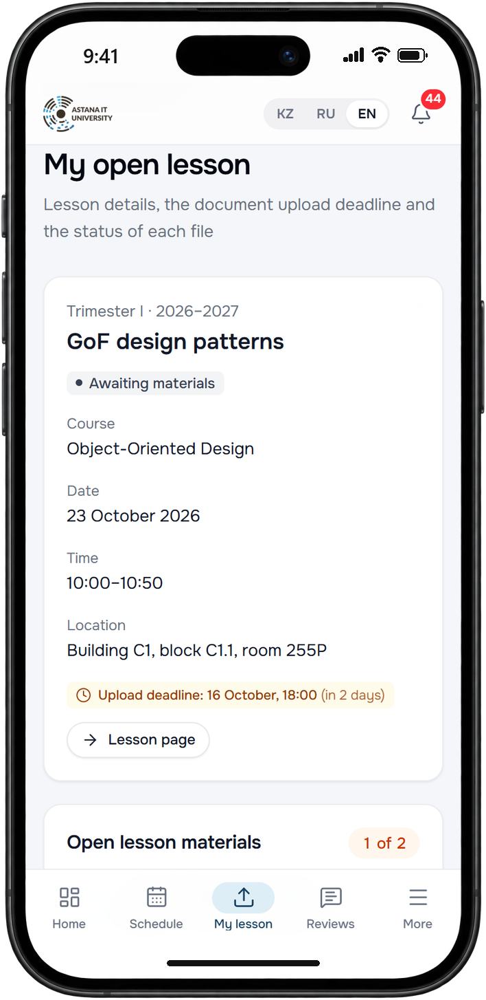
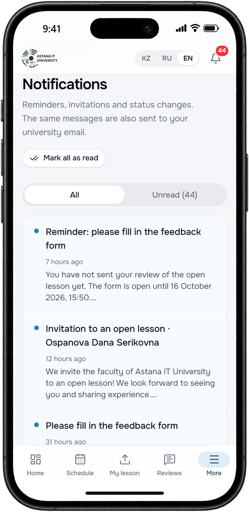
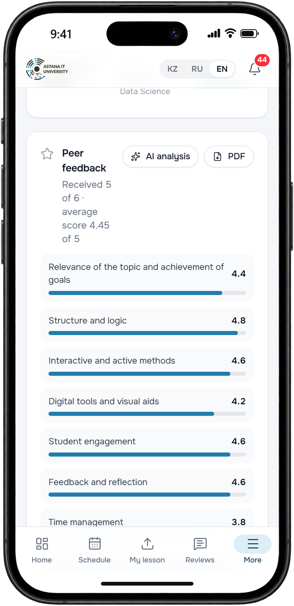
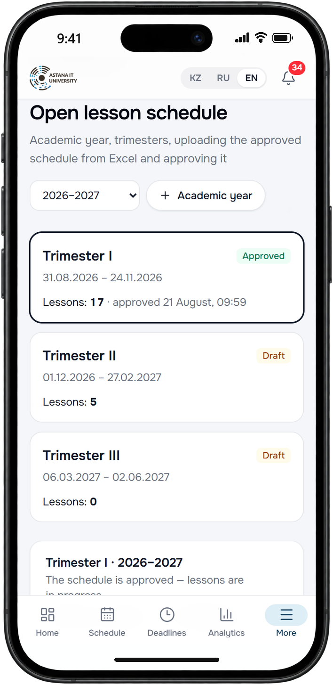
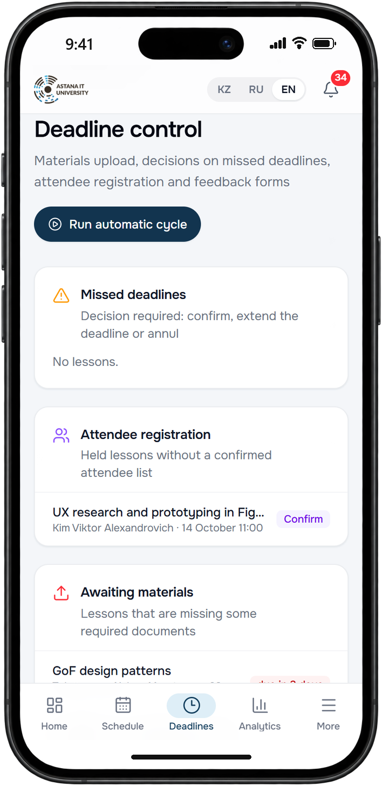
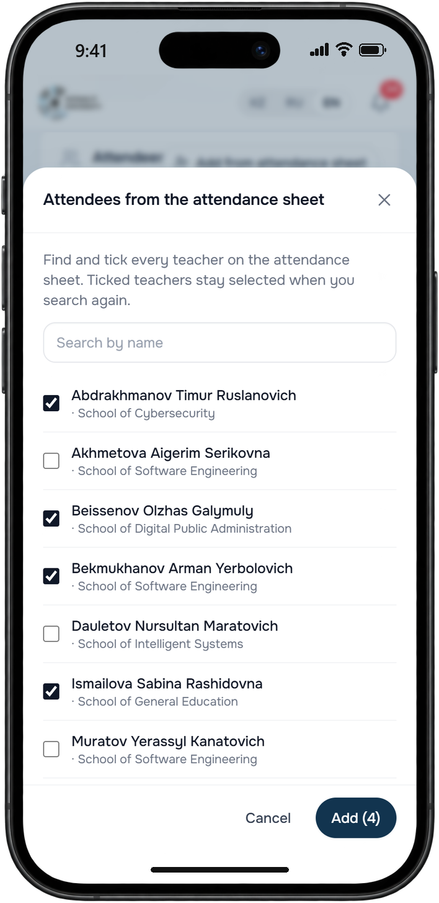
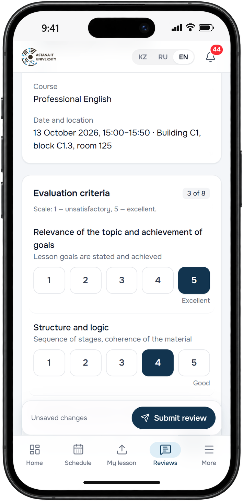
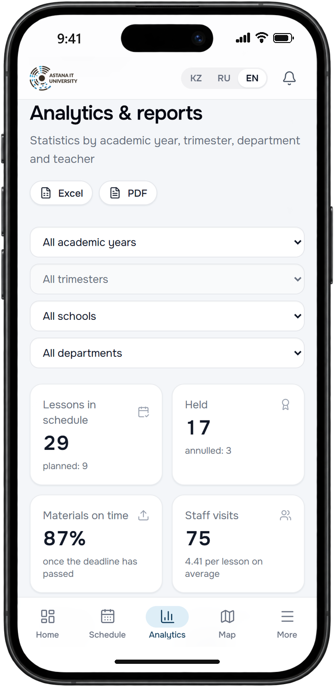
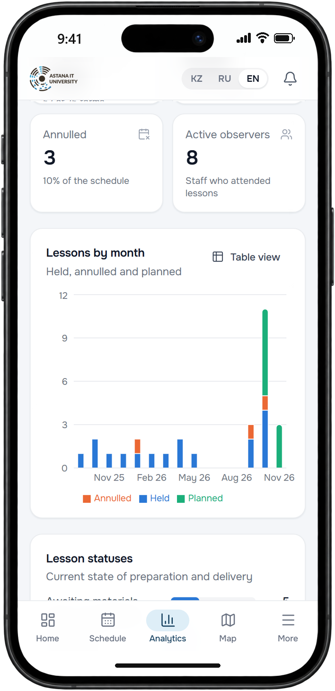
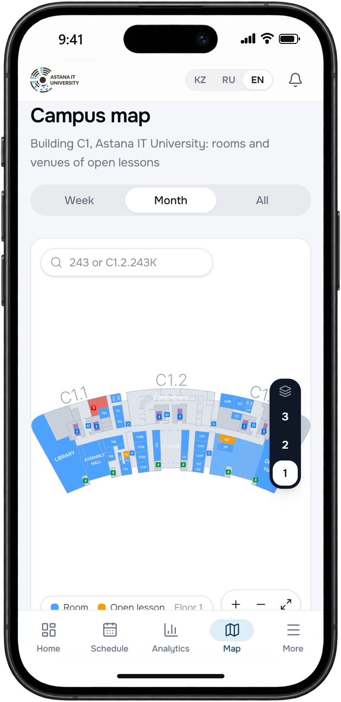

# UX prototype

The prototype is the working web application on demo data: 17 screens, 5 roles, Kazakh, Russian and English. Every
screen works at 390 px, a bottom tab bar keeps the four main sections of each role one tap away. The mock-ups below are
screenshots of the real interface in an iPhone frame (`docs/presentation/iphone-mockups`).

Run it locally with the demo data from the [README](../README.md): `python -m app.seed --reset --lang en` gives English
demo content.

## Design principles

| Principle | What it means in the interface |
| --- | --- |
| Phone first | Every screen works at 390 px, bottom tab bar per role |
| Deadlines always visible | Countdown chips, "1 of 2" progress, reminders 10 and 7 days ahead |
| Feedback in two minutes | 8 criteria with one big tap target (1-5), two short text fields, autosaved draft |
| Accessible by default | WCAG 2.1 AA: keyboard focus, contrast, labels for screen readers, reduced motion |
| Kazakh, Russian, English | KZ / RU / EN switch in the header, notifications, e-mails and posters follow the user's language |

## Scenario 1: teacher prepares the lesson and reads feedback

| Step | Screen | Design choice |
| --- | --- | --- |
| Upload slides and plan |  | A checklist with progress, so the teacher always sees what is still missing |
| Get reminded in time |  | The same message in two channels. The bell shows the unread count |
| Read feedback and reply |  | Overview first (scores, summary), individual reviews below |

Teacher's bottom bar: Home, Schedule, My lesson, Reviews, More.

## Scenario 2: methodologist runs the trimester

| Step | Screen | Design choice |
| --- | --- | --- |
| Import and approve the schedule |  | The schedule stays a draft until approved, so mistakes are fixed before anyone is notified |
| Control deadlines |  | An inbox of exceptions: only what needs action, most urgent first |
| Enter the attendance sheet |  | Multi-select search keeps ticked names. On a phone it opens as a bottom sheet |

Methodologist's bottom bar: Home, Schedule, Deadlines, Analytics, More.

## Scenario 3: colleague is invited, attends and gives feedback

1. Three days before the lesson every teacher receives the generated AITU poster by e-mail and in the app.
2. A staff member of the Academic-Methodological Department marks who attended on the paper attendance sheet. The
   methodologist then enters the list.
3. The colleague fills in the feedback form: 8 criteria with big tap targets, autosaved draft, one confirmation.
   Reminders come after 1 and 2 days, the 3-day window closes by itself.

## Scenario 4: dean and leadership monitor results

| Step | Screen | Design choice |
| --- | --- | --- |
| Filter and compare |  | A dean automatically sees only their own school |
| Charts with a table view |  | The same status colours as in the schedule |
| Find the room |  | Touch-friendly map: pinch to zoom, floor switcher |

Leadership's bottom bar: Home, Schedule, Analytics, Map, More.
